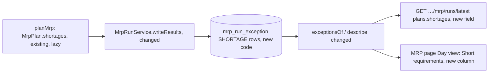

# MRP typed shortages: the stored run, the API and the report show which order, forecast or safety target went short, in priority order

**Status:** implemented (Q1 still awaits the owner's confirmation)
**Created:** 2026-11-05 10:56 UTC
**Issue:** #380 (E18-S04, epic #270) · **Depends on:** proposal timing and demand priority (`implemented/2026-11-01--0738UTC-mrp-proposal-timing-demand-priority.md`, #279), report weeks and marks (`implemented/2026-11-01--1105UTC-mrp-report-weeks.md`, #285), root-requirement ranking (`implemented/2026-11-02--1613UTC-mrp-root-requirement-ranking.md`, #327), all merged · **Design authority:** `.ai/specs/product-brief.md` (R03, R07, R10), `research/CPG-prd001.pdf` §04 "Overdue demand and priority" and §07, `research/CPG-acceptance.md` DEM-018 to DEM-022 and MRP-044

## 📝 TLDR

MRP ranks what it can't cover. Customer orders go first, by earliest original date, then the forecast, then the safety target (#279), and a component need ranks by the requirement at its root (#327). The ranking lives only in the engine. `MrpPlan.shortages` is never stored, never returned and never shown, so no planner can see which order went short. After this change every run stores its ranked shortages with its other rows. `GET …/mrp/runs/latest` returns them per pair, and the report's Day view lists each day's short requirements in priority order, for example "Customer order 00000012, line 1 · due Nov 7 · 8 kg short of 10 kg". No figure, proposal or ranking rule changes.

## 📝 Problem Statement

Six acceptance rows say a user sees the result of the priority rule, and today none of them can pass:

- DEM-018: the safety-stock gap shown as a lower-priority requirement;
- DEM-019: the unmet forecast shown as a shortage;
- DEM-020: O2's shortage shown;
- DEM-021 and DEM-022: the priority's outcome;
- MRP-044: the forecast shortage stays visible.

The engine asserts each rule (`priority/rank-shortages.test.ts`, `plan-mrp.test.ts`), but nothing carries the result out of the engine. #279 Q4 kept the list engine-only and handed its display to E18-S02 (#285). #327 Q9 said "E18-S02 owns showing shortages". E18-S02 shipped marks and weeks without it, so the clause fell between the two stories (lesson 2026-11-05). The report today shows one number per day, `shortage`: how far the balance before proposals is below zero. It doesn't say whose demand that is, or what is still short once the proposals arrive.

The users are planners deciding which customer order goes short, and which to expedite or renegotiate.

## Resolved assumptions (autonomous defaults)

The run was started on #380 by its owner, without answers to its open question. Each answer below is the most reversible one, posted for override. There is no schema change and no new endpoint. The contract changes are additive: a new array on each plan of the latest-run read, and a new stored row code.

| # | Question | Applied default | Why |
| --- | --- | --- | --- |
| Q1 | ⚠ NEEDS HUMAN CONFIRMATION. Is a typed shortage list wanted on the report at all (#279 Q4, #327 Q9)? | **Yes.** Store it, return it, and show it on the Day view. | It is the only way the six rows can pass as written. The other answer is to restate their Then or record an accepted exception, which is the owner's call. This one adds no table, and removing it is one revert. The owner confirms. |
| Q2 | Where is it stored? | In **`mrp_run_exception`**, as **one `SHORTAGE` row per pair** with anything short, after the `BOM_REJECTIONS` rows, on the pair's first short day. Its `details` hold the pair's entries, in priority order, as one text, as `BOM_REJECTIONS` holds its list. | The table already holds a run's warnings (#285), provisional actions (#283) and rejected BOMs (#286) under codes the read tells apart. Its code is a plain string "so a code a later story adds needs no table rebuild" (#280 Q6). A new table would add a migration and touch every migration count (lesson 2026-10-23) for no gain. A row per entry was measured and rejected: at ten times the worst case it stored 162,586 rows, which added 2.7 s to the run and a 334 ms stall to the next run's delete. A row per pair keeps the run within about 5% of `main` (Q9). The rows cascade with the run, so a Test reset clears them. |
| Q3 | What does a row hold? | Everything `MrpShortage` has: `kind`, `originalDate`, `required`, `uncovered`, `document` and `position` where the kind has them, and a planned component's `rootKind`. Quantities are six-decimal texts (R03). The root's date isn't stored: a planned component's `originalDate` is its root's (#327), so the read rebuilds `root` as `{ kind: rootKind, originalDate }`. | The issue asks for the kind, the order line or forecast, the original date, the uncovered quantity and the root. `required` costs one string, and it makes "8 short of 10" readable. |
| Q4 | API shape? | Each plan of `GET …/mrp/runs/latest` gains `shortages: MrpShortageView[]`, in the engine's order: by day, then priority. It is always present, in both views, and empty when nothing is short. Weeks don't change. | It follows `exceptions` and `provisional`, which every plan carries. The day is on each entry, so a client groups the list as it likes. |
| Q5 | Where does the report show it? | On the **Day view**, in a new last column, **Short requirements**, after Warnings. Each day lists its entries in priority order, one line each. The Week view and the pair list don't change. | The issue names "the report's day table for the pair". Putting it last keeps every column that integration tests read by index in its place (lesson 2026-11-01). A week's list would repeat a requirement short on several of its days, and its peak shortage already gives the week's weakest day. |
| Q6 | What does an entry say? | The requirement, its priority date, and how much of it is uncovered: "Customer order 00000012, line 1 · due Nov 7 · 8 kg short of 10 kg", "Forecast · Nov 10 · 15 kg short of 20 kg", "Safety stock · 13 kg short of 25 kg", "Production order 00000004 · start Nov 6 · …", "Transfer 00000002 · dispatch Nov 6 · …", "Proposed production of 00000031 · for customer orders due Nov 7 · …". A planned component names its parent and its root's priority, by root kind: "for production orders starting {date}", "for transfers dispatched {date}", "for customer orders due {date}", "for the forecast of {date}", "for safety stock". Polish has the same lines. | The entry names what #279 ranks by: the kind, then the original date. A planned component's document is its parent material, and its root carries the kind and date it ranks as (#327 Q6). The root's document isn't stored, because one share can serve several orders of one date. |
| Q7 | What do the list and the Shortage column measure? | Different things, and the copy says so. The list names each requirement still uncovered **after proposals** (`rankShortages`), once, on the day it falls due. The Shortage column is the balance **before proposals** below zero, on every day it lasts. A day can show a Shortage figure and no entry, when a proposal covers it or when the requirement short is an earlier day's, still outstanding. It can show an entry and no figure only for the safety gap, since a requirement short after proposals means the balance before them is below zero too. | That is how the engine defines them (#279), and neither changes here. The help and the column's description state the difference. |
| Q8 | A row this image can't read? | **Skipped** on read, like an unreadable mark: an unknown `kind` or `rootKind`, a missing or malformed date or quantity. | A newer image could add a kind before a rollback. One bad row must not fail the report. |
| Q9 | What does the run cost? | `writeResults` ranks each plan's shortages as it writes them. Between plans it yields once 50 ms have passed since its last yield, besides the yield after every 500 rows. `mrp-run-timing.test.ts` is run against `main` before and after, prints the `SHORTAGE` row count beside the other counts and asserts it is above zero, so the ranking is in the measured path. Its stall bound must hold. | #327 made the ranking lazy because no caller read it ("don't compute what no caller reads"). Now a caller does. The ranking is per pair, so the writer can yield between pairs. A count-based yield could still let a few heavy pairs run past the 250 ms stall budget, and a clock-based one can't. The read adds rows to the query `exceptionsOf` already sends. |
| Q10 | Split the story? | No. | Storing a list nobody reads, or showing one that isn't stored, would ship nothing a planner can use. |
| Q11 | A material with an unreadable row? | **No shortages**, like its warnings and its transfer exceptions (#316): `planMrp` gives such a material's plans an empty `shortages`. Its pairs keep Invalid UoM Conversion. | Its balances are incomplete, so a ranked list would name requirements as short, or covered, on figures MRP itself distrusts. |

## 📝 Proposed Solution

1. **Stored form.** A new module `core/src/domain/mrp/report/stored-shortages.ts` holds `MRP_SHORTAGE_CODE = "SHORTAGE"`, `isMrpShortageCode`, `toStoredShortages(material, location, shortages)` (null when nothing is short) and `readStoredShortages(details)`, which leaves out an entry it can't read (Q8).
2. **Write.** `MrpRunService.writeResults` gets one more loop after the rejected BOMs. It goes plan by plan in the run's order, reads `plan.shortages` (ranked on that read), creates the pair's one `SHORTAGE` row at the next position, and yields on time between plans (Q9). `rankShortages` doesn't change. In `planMrp`, `withShortages` gives an unreadable material's plans an empty list (Q11).
3. **Read.** `exceptionsOf` already reads the page's `mrp_run_exception` rows in position order, and gains a `shortages` map by pair. `describe` puts it on each plan. `MrpPlanView` gains `shortages`.
4. **Screen.** `PlanDays` gains its last column. A new `MrpShortages` component (`components/mrp/mrp-shortages.tsx`) renders a day's entries as an ordered list, plus `shortageText` for the line. The copy is in the EN/PL `mrp.report.shortages` messages and the `mrp` help topic.
5. **Contract docs.** `BACKWARD_COMPATIBILITY.md` §4 records the plan field and the stored code, with the rollback note.

**Alternatives considered.**
- *A new `mrp_run_shortage` table.* It would mean a migration and every count it moves. It also brings nothing the exception table's coded rows lack: the read already filters by run, material and location through its unique index.
- *Re-rank on read.* It would need the whole snapshot again, and the report shows the stored run (R10).
- *Marks.* Marks are warnings about documents and proposals with their own `kind` contract. A shortage is a requirement, so mixing them would change what clients switching on mark kinds receive.
- *Show only the first short requirement.* That loses the order, which is what the six rows ask to see.

## 📝 Architecture

```
core/src/domain/mrp/plan-mrp.ts                      no shortages for an unreadable material      (changed)
core/src/domain/mrp/report/stored-shortages.ts         SHORTAGE code, to/from stored row            (new)
core/src/services/mrp/mrp-run.service.ts               write after BOM_REJECTIONS; read by pair     (changed)
core/src/services/mrp/mrp-run-view.ts                  MrpShortageView, MrpPlanView.shortages       (changed)
app/src/components/mrp/mrp-shortages.tsx               a day's entries and their text               (new)
app/src/components/mrp/mrp-report.tsx                  PlanDays' last column                        (changed)
app/src/i18n/messages/{en,pl}.ts, app/src/help/topics.ts   copy                                     (changed)
BACKWARD_COMPATIBILITY.md, research/CPG-acceptance.md  contract and six rows                        (changed)
```



The ranking rule, sizing, proposals, exceptions, marks, weeks, acceptance and the automatic batch don't change. The only new work at run time is the ranking that #327 deferred and the rows it writes.

## 📝 Data Model

No migration. A `SHORTAGE` row in `mrp_run_exception` holds one pair: `date` is its first short day, and `details` is `{ entries }`, the pair's entries in `rankShortages` order, separated by `;`. Each entry is eight space-separated fields, `-` where the kind has none:

| field | value |
| --- | --- |
| `date` | the bucket the requirement counts in |
| `kind` | one of `MRP_SHORTAGE_KINDS` |
| `originalDate` | ISO date |
| `document` | customer order, component, transfer, planned component: business ID (a planned component's parent material) |
| `position` | customer order: the line's position, decimal from 0 |
| `required`, `uncovered` | six-decimal texts above zero (`formatDecimal`, fixed) |
| `rootKind` | planned component: the root's kind (never `planned-component`); its date is the entry's `originalDate` |

For example, `2026-10-06 customer-order 2026-10-06 00000002 0 10.000000 8.000000 -`. IDs and dates hold no space.

Rows follow every `BOM_REJECTIONS` row, so each earlier row keeps its position, plan by plan in `planMrp`'s plan order.

## 📝 API Contracts

`GET /api/tenants/{tenant}/mrp/runs/latest`: each entry of `plans` gains

```ts
shortages: {
  kind: "component" | "transfer" | "customer-order" | "planned-component" | "forecast" | "safety-target";
  date: string;            // the day it is short on
  originalDate: string;    // its priority date
  document: string | null; // order, production order or transfer ID, a planned component's parent; null for forecast and target
  position: number | null; // a customer-order line's position; null otherwise
  required: string;        // six-decimal text
  uncovered: string;       // six-decimal text, above zero, at most `required`
  root: { kind: "component" | "transfer" | "customer-order" | "forecast" | "safety-target"; originalDate: string } | null; // a planned component's root priority; null otherwise
}[]
```

It is additive, in both `bucket` views, and readable by every account and on a read-only tenant (TEN-018), as the rest of the read is. `POST …/mrp/runs` answers as before.

## 📝 UI/UX

- **Day view.** A last column, **Short requirements** ("Niepokryte potrzeby"), after Warnings. A day's entries make an ordered list in priority order, one line each (Q6), with the date drop-the-year rule of `shortDate` and quantities in the reader's locale with the base unit (#304). It is text, so there is no colour-only signal. The row keeps its existing tone. An empty day shows nothing.
- **Intro copy.** The Day view's intro gains one sentence: "Short requirements lists what is still uncovered after proposals, in the order MRP serves it." It has a Polish twin.
- **Help (EN, PL).** The `mrp` topic's report paragraph explains the column and Q7's difference. Its API paragraph lists `shortages` with its fields.
- **Wrapping.** The column is `whitespace-normal` like Warnings, so long lines wrap. The pinned columns (#311) don't move.

Prototype: none. It is one more text column in the existing Day table (`.ai/specs/assets/mrp-report-weeks/mockup-02-day-marks.png` shows Warnings, the column before it).

## 📝 Edge Cases & Failure Scenarios

- **Nothing short:** `shortages: []`, and the column is empty on every day.
- **An overdue order line:** it counts today and ranks by its own required date (#279), so its entry is on today's day with "due" in the past, with the year if it differs.
- **Two lines of one order on one day:** two entries, by position (DEM-021's tie-break).
- **The target and a requirement on one day:** the target comes last (DEM-018, DEM-022).
- **A planned component with two roots:** two entries, each with its own root (#327).
- **Two needs of one parent with the same root:** two parent proposals with different need dates can both need the component on one day for one root priority. The engine keeps them apart (by the parent's need date, `requirements.ts`), but `MrpShortage` doesn't carry that date, so the two entries can read the same. Each is a real requirement, and their sum is what is short. Carrying the parent's need date is an engine change, out of scope.
- **A material with an unreadable row:** no entries (Q11).
- **A pair with no planning parameters:** its shortages are still ranked and stored. `planMrp` ranks every pair (#279).
- **Test reset:** the runs are deleted and their rows cascade, so the report has no run and no shortages.
- **Rollback to the previous image:** it doesn't know `SHORTAGE`, so its read lists those rows among each plan's exceptions with the fallback message, as #286 noted for `BOM_REJECTIONS`. There is one per pair with anything short. Its engine, not the read, empties a pair's proposals, so its proposals are unaffected. Running MRP once after a rollback deletes them; `BACKWARD_COMPATIBILITY.md` says so.
- **A row a newer image wrote:** skipped (Q8).

## 📝 Risks & Impact Review

- **Run time.** Ranking every pair returns to every run (#327 measured it once at up to twice `planMrp` on the ten-times worst case, before its own optimisations). Q9 yields between chunks of pairs, and the timing test is compared with `main` before and after. The phase fails if the stall budget is exceeded.
- **Row count.** One row per pair with anything short: 29 on the realistic Test dataset, 300 at ten times the worst case. A pair's entries are bounded by the snapshot's documents plus 90 days of the target, and a page reads at most 25 pairs' rows.
- **Tests that count stored rows.** Any test counting `mrp_run_exception` rows by exclusion, or reading them all, now sees `SHORTAGE` (lesson 2026-11-01). Grep for both `MrpRunException` and raw `mrp_run_exception` SQL (`mrp-run.service.test.ts`, `mrp-run-timing.test.ts`), and count by the codes meant.
- **Contract.** One additive field and one stored code, recorded in `BACKWARD_COMPATIBILITY.md`. Clients comparing whole plans exactly see a new key.
- **Reversibility.** No schema change. Removing the write stops new rows, and the next run deletes the old ones.

## 📝 Decisions in play

R10 (the report shows the stored run) and R03 (exact six-decimal quantities) hold, and #279's ranking is unchanged. Q1 answers #279 Q4 and #327 Q9, the channel for the typed shortages, and needs Piotr12's confirmation.

## Out of scope

- Changing the ranking or any quantity.
- Shortages in the Week view, the pair list, exceptions or marks.
- Pegging a planned component's root to its documents (#327 keeps it to priorities).
- Notifying anyone or creating documents from a shortage.

## 📋 Phasing

One phase, one PR: a vertical slice from the stored row to the screen, which only makes sense whole (Q10).

## 📋 Implementation Plan

1. **Stored form and engine.** `report/stored-shortages.ts` with `toStoredShortages` and `readStoredShortages`, and unit tests: every kind's entry, round trip, and each malformed entry left out (unknown kind or root kind, a bad date, a zero or malformed quantity, a customer order without a document or position, a planned component without its root). `planMrp`: an unreadable material's plans have no shortages (Q11), with a `plan-mrp.test.ts` case.
2. **Write and read.** `writeResults` writes one `SHORTAGE` row per pair after the rejected BOMs and yields on time between plans (Q9), with a test that it yields. `exceptionsOf` keeps `SHORTAGE` rows apart, and `describe` and `MrpPlanView` carry `shortages`. `mrp-run.service.test.ts` uses the six rows' fixtures against a real SQLite file: DEM-018 (12 in stock, an order of 10, a target of 25), DEM-019 (15 available, an order of 10 and a forecast residual of 20 on one day), DEM-020 (O1 due before O2), DEM-021 (two same-date lines, both input orders), DEM-022 (a forecast of 40 and a target top-up of 20), and MRP-044's multilevel case (a raw component short under a parent's customer order and forecast, with the root). For each, the stored rows, `latest()`'s `shortages` and their order are asserted, and the exceptions stay as before. The same test covers a read-only tenant's read, a Test reset clearing them, a second run replacing them, and the run's other row positions unchanged. Fix any test that counts `mrp_run_exception` rows by exclusion. Run `mrp-run-timing.test.ts` against `main` and the branch and record the figures in the run log. It prints and asserts the count of pairs with shortages.
3. **Screen and copy.** `MrpShortages` and `shortageText` for every kind and root kind, the column in `PlanDays`, the EN/PL messages, the intro sentence and the help paragraphs. Component tests for each kind's text in both languages, the priority order within a day, a day with none, and the column's place (last). Page and help tests, with the dictionary and glossary guards.
4. **Contract docs and catalogue.** `BACKWARD_COMPATIBILITY.md` §4 gets the field and the stored code, with the rollback note (the row volume, and run MRP once after a rollback). In `research/CPG-acceptance.md`, DEM-018 to DEM-022 and MRP-044 move to Passed (automated), each Evidence line naming the test that asserts every clause of its Then (lesson 2026-11-05), and the catalogue's counts are updated.
5. **Integration.** A new `tests/integration/mrp-shortages.test.ts` in Prod with its own records: one pair with no planning parameters, so nothing is proposed and the ranking shows as is. It has stock, two customer orders on consecutive days, a forecast on the later day, and a safety target. After a run, `GET …/mrp/runs/latest` returns the shortages in priority order with kind, document and uncovered quantity, the same for a normal user and the admin, and also while the tenant is read-only. The page's Day view lists the same entries in the same order. Run it with `mrp-report.test.ts` and `mrp-report-api.test.ts`, whose tables gain a column.
6. **Full gate**, plus `smoke.test.ts` only if a migration slipped in (none is planned).

## Acceptance criteria

- With DEM-018…022's and MRP-044's fixtures, after a run the stored rows, `GET …/mrp/runs/latest` and the Day view each show the requirement that went short, its kind and its uncovered quantity, in priority order: customer orders by original date, then the forecast, then the safety target, and a planned component by its root.
- A read-only tenant reads them too. A Test reset clears them with the run, and a new run replaces them.
- No figure, proposal, exception, mark or week of any existing test changes.
- The six rows read Passed (automated). EN and PL copy, help included. 100% coverage of the change.

## Implementation notes

- **One row per pair, not per entry (Q2).** The first build stored one `SHORTAGE` row per entry. At ten times the worst case for proposals, that was 162,586 rows (108,476 of them planned components under provisional parents). Against `main` on the same machine, the run went from about 4.15 s to 6.9 s, and the stall from 271 to about 560 ms, most of it the next run's delete of 216,718 exception rows (334 ms). With one row per pair holding its entries as one text, the run measured 4,332 and 4,376 ms (stall 271 and 275 ms), and the other sizes stayed within about 5% of `main` (realistic 260 against 254 ms, ten times 2,820 against 2,700 ms). The Data Model above describes the shipped form.
- **Positions start at 0.** A customer-order line's `position` is 0-based, as `INVALID_UOM_CONVERSION`'s `document` (`00000012/0`) shows. The reader accepts 0 and the API keeps the stored position, but the screen names the line from 1, as the order screens do ("Customer order 00000012, line 1", code review of #387). Purchase-order lines start at 1, so the marks are already right. Invalid UoM Conversion still names a customer-order line from 0, which is follow-up #390.
- **Read guards (code review).** A pair's row replaces its empty list instead of spreading its entries into it, so a very long list can't exceed the call stack. An entry whose `uncovered` is above its `required` is left out (Q8).
- **The column's width.** At its natural width every entry wrapped two or three times. The column has `min-w-80`, and the table scrolls in its own region, so nothing on the page scrolls sideways (`mrp-report.test.ts`, 1280 and 390 px).
- **Q1** is still the owner's to confirm on #386.

