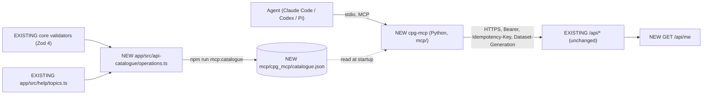

# Local MCP server: CPG's API as agent tools, over stdio, in Python

**Status:** implemented
**Created:** 2026-11-22 08:18 UTC
**Issue:** #393 (owner's answers Q1–Q12 recorded there) · **Follow-up:** #398, the onboarding skill, blocked by this spec · **Design authority:** `.ai/specs/product-brief.md` (R03, R05, R07, R08, R10, D04), `BACKWARD_COMPATIBILITY.md` §4, implemented specs `2026-10-19--1053UTC-api-tokens` and `2026-10-19--1548UTC-api-idempotency`

## 📝 TLDR

Today an agent such as Claude Code, Codex or Pi can only reach CPG by hand-writing HTTP calls. It would have to learn 116 handlers from prose and get `Idempotency-Key`, `Dataset-Generation` and `version` right on every write. After this change a planner runs `cpg-mcp`, a local Python MCP server over stdio, with a token from `/admin/tokens`. The agent then gets 24 tools (34 for the admin), and they cover every API operation except the Test reset and the two template downloads.

The app gains two things. `GET /api/me` tells the server the caller's role. An operation registry generates the tools' JSON schemas from the existing Zod validators, and a test fails whenever the API and the tools drift apart. No existing route, header or rule changes.

## 📝 Problem Statement

- **The surface is large.** 81 route files under `packages/app/src/app/api/` export 116 handlers: 48 GET, 44 POST, 18 PATCH, 5 DELETE, 1 PUT. Two of them, the template downloads, use `export async function GET`. A 1:1 tool set would cost an agent tens of thousands of tokens of tool definitions before it does anything, and it would pick the wrong tool more often (#393, Q1).
- **Writes have a strict, uniform contract that an agent gets wrong easily** (`packages/app/src/auth/api-write.ts`, `core/src/http/idempotency-key.ts`):
  - A bearer token only.
  - A fresh `Idempotency-Key` per write. Reusing it with another body is 409.
  - `Dataset-Generation` is required for Test (428) and checked for staleness (409 `GENERATION_STALE`).
  - Edits carry `version`.
  - Quantities are decimal strings (R03).
- **No machine-readable description of the API exists.** Inputs are Zod 4 schemas in `packages/core/src/validators/`, imported route by route.
- **No route returns the caller's role**, so a client can't tell the admin's tools from a normal user's.

## Resolved assumptions (autonomous defaults)

The owner answered Q1–Q12 on #393: tiered tools, schemas generated from Zod, `/api/me`, Prod writes allowed with an "ask first" description, no Test reset, base URL `https://cpg.baby`, `mcp/` in this repo, Python unit tests only in CI, imports and user/token admin included. The skill went to #398. The design questions those answers left open are resolved here:

| # | Question | Chosen answer | Rationale |
|---|---|---|---|
| A1 | Where does the operation registry live? | `packages/app/src/api-catalogue/operations.ts`, beside the routes it describes. The generator script is `packages/app/scripts/mcp-catalogue.ts` (run with `tsx`). | The registry pairs routes with core validators and with the app's help topics, and only `app` sees both. `core` stays free of URL knowledge. |
| A2 | Who composes tools from operations? | The registry lists operations only. The Python server maps operations to tools (`mcp/cpg_mcp/tools/`). | Tool shape is the MCP's design concern, and the app shouldn't change when a tool is regrouped. Two parity tests, one per side, keep both complete. |
| A3 | FastMCP decorators or the low-level server? | The low-level `mcp.server.lowlevel.Server` (`list_tools` / `call_tool`), with input schemas taken from `catalogue.json`. | FastMCP derives schemas from Python signatures, which would mean hand-writing models: Q2 C, rejected. |
| A4 | When does a write retry? | Once, with the same key, and only on a connection error, a timeout, or 502/503/504 (kamal-proxy). Never on 500 or 4xx. | A same-key retry is a replay at worst. It is safe even while the first request is still running: the second one loses the key's unique-index race, re-attempts and replays the stored answer (`core/src/services/idempotency/idempotency.service.ts:93`). A 500 may have partly run, so it goes back to the agent. |
| A5 | How are help topics exposed? | The catalogue bundles every topic in EN and PL from `HELP_TOPIC_IDS` and its texts. `cpg_help` reads them, and the server also lists them as MCP resources `cpg://help/{id}`. | There is no help API, and adding one would be new surface. The skill (#398) links topics by id. |
| A6 | Are the tool names a protected contract? | Yes. Tool names and environment variables are listed in a new `BACKWARD_COMPATIBILITY.md` §6 "MCP server". | User agent configs and #398's skill rely on them. |
| A7 | Python dependency hygiene? | `uv.lock` is committed, and the CI job runs `pip-audit`, the Python counterpart of the `npm audit` rule. | The engineering standards' dependency-hygiene minimum, applied to the new toolchain. |
| A9 | One save tool for both create and update? | Yes. Every `cpg_save_*` tool takes `action: "create" \| "update"` (plus `"remove"` where a DELETE route exists). Its input schema is a `oneOf` of one object per action, discriminated by `action` as a `const`. `update` and `remove` require the record's key and `version`. The client validates against the chosen branch only, so its error names that branch's fields. | One tool per document keeps the count down (Q1 A). A discriminated `oneOf` is the JSON Schema shape models fill most reliably, and a per-branch check avoids `oneOf`'s unreadable combined errors. |
| A10 | A field a PATCH refuses (`z.never().optional()`, lesson 2026-10-20)? | The generator drops it from the `update` branch and lists it in the branch's `description` ("cannot change: type, baseUnit"). | `z.toJSONSchema` renders it as `not: {}`, which tells a model nothing. The server's 400 stays the authority. |
| A8 | A password in a tool argument (`cpg_users` reset or create)? | Allowed (Q9 A). The tool description tells the agent to ask the human for the password and not to invent or repeat one. The server never logs arguments. | API parity, R07. The password travels in the agent's context, which the Risks section states. |

## 📝 Proposed Solution



The server is a thin client. Validation, authorization, read-only refusals (R05) and audit (R08, `channel: "api"`, the token's id) all stay on the server, exactly as for any other token. The MCP only removes the mechanics the agent shouldn't have to carry.

Alternatives considered:
- **1:1 tools and one tool per concept with an `action` enum.** The owner rejected both (Q1).
- **A runtime `GET /api/openapi.json`.** Rejected because it would be a new public contract (Q2).
- **Hand-written Python schemas.** Rejected because they drift silently (Q2).

## 📝 Architecture

### Operation registry (app)

`operations.ts` exports `API_OPERATIONS`, one entry per route handler:

```ts
{ id: "materials.create", method: "POST", path: "/api/tenants/{tenant}/materials",
  role: "admin" /* | "any" */, write: "tenant" /* | "global" | null */,
  body: materialCreateSchema /* or query: materialApiQuerySchema */, summary: "Creates a material …" }
```

- `id` follows `concept.action`.
- `role` repeats the route's `authorize`/`assertAdmin`.
- `write` names the wrapper: `tenantApiWrite` means tenant (key plus generation), `apiWrite` means global (key only), and `null` is a read.
- `query`/`body` reference the schema the route or its service parses. Reports and the latest MRP run parse inside their service (`stockReportQuerySchema`, `varianceReportFieldsSchema`, `demandReviewQuerySchema`, `mrpLatestQuerySchema`). The registry imports those schemas from `@cpg/core/validators/…`.
- The JSON conversion lives in core as `toToolJsonSchema(schema)` (`core/src/http/tool-json-schema.ts`, exported from `@cpg/core`), because only `core` depends on `zod`. The app's generator calls it.

The generator writes `mcp/cpg_mcp/catalogue.json` with stable key order:
- each schema is converted with `z.toJSONSchema(schema, { io: "input", unrepresentable: "throw" })`. `io: "input"` describes what the client sends before transforms, such as decimal strings and dates. `throw` makes a schema that can't be represented fail the generator, and its test runs over every entry, rather than silently advertising `{}`. Refused fields follow A10;
- the help topics in both locales;
- a `generatedFrom` hash of the registry.

### Python server (`mcp/`)

```
mcp/
  pyproject.toml  uv.lock  README.md
  cpg_mcp/
    __main__.py        # entry point `cpg-mcp`
    config.py          # env: CPG_BASE_URL, CPG_API_TOKEN, CPG_TENANT
    client.py          # httpx client: envelope, auth, keys, generation, retry
    catalogue.py       # loads catalogue.json, validates arguments against its JSON schemas
    server.py          # low-level MCP Server: list_tools/call_tool, resources, role filter
    tools/             # one module per tier: context, reads, writes, admin
    catalogue.json     # generated, committed
  tests/               # pytest, respx
```

- Python ≥ 3.12, with `mcp` (the official SDK), `httpx` and `jsonschema` at runtime. Dev tools: `pytest`, `pytest-cov`, `respx`, `ruff`, `pyright` and `pip-audit`.
- Install and run with `uvx --from "git+https://github.com/Piotr12/CPG#subdirectory=mcp" cpg-mcp`, or `uvx --from ./mcp cpg-mcp` from a checkout.
- **Startup.** The server reads the configuration, loads the catalogue, then calls `GET /api/me` and `GET /api/tenants`.
  - It registers only the tools whose operations the role may call. A tool that mixes roles, such as `cpg_users`, offers only the actions that role may run.
  - A missing token, or a 401 from `/api/me`, exits with a one-line message on stderr that names the variable, never its value.

### Client behaviour (`client.py`)

- **Headers.** Every call sends `Authorization: Bearer <CPG_API_TOKEN>` and a `User-Agent: cpg-mcp/<version>`. The token is never logged, echoed or included in an error.
- **Writes.**
  - The client sends a new UUID v4 `Idempotency-Key` per tool call and retries per A4.
  - A tenant write also sends `Dataset-Generation` from a per-tenant cache, filled from `GET /api/tenants/{tenant}` at the tenant's first write.
  - A reply with `Idempotent-Replayed: true` becomes `"replayed": true` in the tool result.
- **Stale generation.** On 409 `GENERATION_STALE` or 428 `GENERATION_REQUIRED` the client refreshes the cache and returns a tool error that says Test was reset and every ID read earlier is void. It doesn't retry.
- **Errors.** Every `{ ok: false, error }` becomes an MCP tool error (`isError: true`) whose text is compact JSON `{ status, code, message, fieldErrors?, params? }`, so the model can fix a field and call again.
- **Version conflicts.** An edit's version conflict also attaches a fresh read of the record, through the matching `*.get` operation.
- **Arguments.** Arguments are validated against the catalogue's JSON Schema before any HTTP call, which answers `VALIDATION_FAILED`-shaped errors locally. The server's validation stays the authority.
- **Results.** Tool results are the API's `data` as compact JSON.
- **Timeouts.** Reads time out at 30 s and writes at 120 s, which covers an automatic MRP run on the realistic dataset.
- **Prod writes (Q4 B).** Every write tool that can target Prod states in its description: "On the prod tenant, ask the human to confirm before calling." The server enforces no Prod flag of its own.

### Tool set

Every tenant tool takes `tenant` (`test` | `prod`), defaulting to `CPG_TENANT`, which defaults to `test`.

| Tier | Tool | Operations it fronts |
|---|---|---|
| Context | `cpg_whoami` | `me.get`, `tenants.list` |
| | `cpg_help(topic?, locale?)` | bundled help, no HTTP (A5) |
| | `cpg_preferences(language?, theme?)` | `preferences.get`, `preferences.update` |
| Reads | `cpg_list(entity, query, parent?)` | the list GETs. `entity` takes one of these values: materials, locations, customers, suppliers, boms, planning-parameters, safety-stock-targets, forecasts, customer-orders, shipments, goods-issues, goods-receipts, purchase-requisitions, purchase-orders, production-orders, production-order-options, production-completions (with `parent`), transfers, stock, users, tokens |
| | `cpg_get(entity, id, revision?)` | the record GETs, including BOM revisions and stock movements |
| | `cpg_report(kind, query)` | `reports.stock`, `reports.variance`, `reports.demand-review`, `mrp.runs.latest` |
| | `cpg_audit(scope, query)` | `audit.global`, `audit.tenant` |
| Planning | `cpg_mrp_run(mode?)`, `cpg_mrp_accept_proposal(run, proposal)` | `mrp.runs.create`, `mrp.proposals.accept` |
| Documents | `cpg_save_customer_order`, `cpg_save_shipment`, `cpg_save_purchase_requisition`, `cpg_save_purchase_order`, `cpg_save_production_order`, `cpg_save_transfer` | POST without `id`, PATCH with `id` and `version` |
| Postings | `cpg_post_goods_issue`, `cpg_post_goods_receipt`, `cpg_post_production_completion(preview?)`, `cpg_transfer_move(action: dispatch \| receive \| write-off)`, `cpg_stock_correction`, `cpg_stock_import(file_path, commit)` | the posting POSTs and the completion preview GET. The stock import reads the file and sends it as base64 |
| Lifecycle | `cpg_document_close(kind, id, action: cancel \| close-early)`, `cpg_reverse(kind, id, sub_id?)` | 6 cancel and 5 close-early routes; 3 reversals |
| Tokens | `cpg_revoke_token(id)` | `tokens.revoke`. No create (R07) |
| Admin | `cpg_save_material`, `cpg_material_conversion(action)`, `cpg_save_named_record(kind: location \| customer \| supplier)`, `cpg_save_planning_parameter`, `cpg_save_safety_stock_target`, `cpg_save_forecast`, `cpg_save_bom`, `cpg_import(file_path, commit)`, `cpg_set_read_only(tenant, read_only)`, `cpg_users(action: create \| set-active \| reset-password)` | master data, the master-data import, the read-only flag (a global write) and users. Remove actions map to the DELETE routes |

That is 24 tools for a normal user and 34 for the admin. The admin-tier tools that contain any-role operations, such as the forecast reads, stay reachable through `cpg_list` and `cpg_get`.

**Intentional exclusions**, listed in `mcp/cpg_mcp/exclusions.py` with their reasons:
- `tenants.test-reset` (Q5 A);
- `import.template` and `stock-import.template`, which are binary `.xlsx` downloads for a human.

`tenants.get` is used internally for the generation cache.

## 📝 API Contracts

New: `GET /api/me`. Any signed-in caller, by session cookie or bearer token. A read, so no key. The answer:

```json
{ "ok": true, "data": { "id": "…", "username": "planner1", "role": "user", "token": { "id": "…", "name": "laptop agent" } } }
```

- `token` is `null` for a session.
- Without a credential the answer is 401 `UNAUTHORIZED`, through `requireApiUser`.
- It runs through `apiHandler`, so the answer carries `Cache-Control: no-store`.
- It never returns the token's secret or hash.
- It is listed in `BACKWARD_COMPATIBILITY.md` §4.

No other route changes.

## 📝 Edge Cases & Failure Scenarios

- **A dropped connection after the server committed.** The same-key retry gets the stored answer and reports `replayed: true`. With no retry, the agent sees a transport error that names the key and can call the tool again, which creates a new key. The tool description says to re-read the record first, because a second call with a new key is a second write.
- **Test was reset during a session.** Stale-generation error as described above, and the IDs read earlier are void.
- **The tenant is read-only (R05).** The server's refusal code reaches the agent unchanged.
- **The token is revoked or its user deactivated mid-session (R06).** The next call is 401. The tool error tells the human to create a new token on `/admin/tokens` and restart the server.
- **A normal user's token.** Admin tools are never listed. If the role changes mid-session, calls answer 403 until the server restarts.
- **The catalogue is out of date with the server it talks to** (an old `cpg-mcp` against a newer app). The server's strict schemas answer `VALIDATION_FAILED` for removed fields. A new optional field just isn't offered until the user upgrades. `cpg_whoami` reports the catalogue's `generatedFrom` hash so a mismatch can be diagnosed.
- **A large list.** Results are the API's own page, of 100 at most, and paging hints such as `nextBefore` and `page` are passed through unchanged.
- **The file in `cpg_import` or `cpg_stock_import` is missing or unreadable.** A tool error names the path, and nothing is sent.

## 📝 Risks & Impact Review

- **The default base URL is production (Q6 B), and Prod writes are allowed (Q4 B).** An unconfigured server talks to `cpg.baby`, and only the tool descriptions and the default tenant `test` stand between an agent and Prod data. A test asserts that every Prod-capable write tool carries the warning text. Audit still attributes every change to the token (R08). This is the owner's call on #393, recorded here so it isn't lost.
- **A password in the agent's context** (A8), for `cpg_users` create and reset only.
- **A second toolchain in CI (Q8).** The new `python` job joins `.github/workflows/ci.yml`, which `deploy.yml` calls, so a red Python test blocks deploys. `tests/ci-workflow.test.ts` pins job timeouts and must learn the new job.
- **New contracts.** `GET /api/me` (§4) and the tool names and environment variables (A6, a new §6). The catalogue JSON is an internal build artefact, not protected. Rolling back means removing the route and the `mcp/` folder. Nothing persists: no schema change, no migration.
- **No Python integration test in CI (Q8 B).** Behaviour against the real server is proven by the client's unit tests against recorded envelopes, plus the registry tests on the app side. A manual run against Test is recorded on the implementation PR.

## 📝 Decisions in play

The spec relies on R03, R05, R06, R07 (API parity; tokens are created in the UI only), R08 and D04 (no new business behaviour). It supersedes none. The owner's answers on #393 settle the rest.

## Out of scope

- The onboarding skill and the `cpg_onboarding` MCP prompt, which are #398.
- A remote or HTTP-transport MCP server, OAuth, and token creation (R07).
- Changes to any existing route, header, validator or message. Gaps the MCP exposes get their own issues (D04).
- Publishing to PyPI (Q7 A).

## 📋 Phasing

1. **The app side.** `GET /api/me`, the operation registry, the generated catalogue, and their parity and drift tests. It ships on its own: the catalogue is committed but nothing reads it yet.
2. **The Python skeleton and reads.** The package, config, client, catalogue loader, role filter, the context and read tools, and the CI job.
3. **Writes.** Planning, documents, postings, lifecycle and tokens.
4. **Admin and parity.** The admin tools, imports and users; the full parity check (every catalogue operation fronted or excluded); `mcp/README.md`; and `BACKWARD_COMPATIBILITY.md` §6.

## 📋 Implementation Plan

### Phase 1: app side

1. Add `GET /api/me` (`packages/app/src/app/api/me/route.ts`). It maps the caller from `requireApiUser` directly: `Actor` already has `userId`, `username` and `role`, and `ApiActor` adds `tokenId` and `tokenName`. No service is needed. Route tests cover the session, the bearer, none (401), and no secret or hash in the answer. Add it to `BACKWARD_COMPATIBILITY.md` §4.
2. Add `toToolJsonSchema` in core, with tests for `io: "input"`, a transform, and a refused `z.never()` field (A10). Add `packages/app/src/api-catalogue/operations.ts` with one entry per handler: today's 116 plus `me.get`. Unit tests check unique ids, `{param}` paths, and consistent `role`/`write` values.
3. Add `tests/api-catalogue.test.ts`. It walks the route files as `tests/api-writes.test.ts` does and fails when:
   - an exported method has no registry entry, or an entry has no route;
   - an entry's `write` disagrees with the wrapper (`apiWrite`, `tenantApiWrite` or `testResetApiWrite`);
   - `role: "admin"` disagrees with `authorize: assertAdmin` or `assertAdmin(` on that export;
   - a named `body` or `query` schema isn't imported by the route file, or by the service file whose method the route calls.

   Known limit: this proves the schema is on the request's path, not that it is the only parse. A route that parses a second schema inline would still pass. Code review covers that, and the registry's doc comment says so.
4. Add `packages/app/scripts/mcp-catalogue.ts`, the folder's first file, run by `npm run mcp:catalogue` with `tsx`. A pure `buildCatalogue()` sits apart from the `main()` that writes the file, and both are covered at 100% because `vitest.config.mts` already includes `packages/*/scripts`. Tests cover: the generated output equals the committed `mcp/cpg_mcp/catalogue.json`; a changed schema yields a different hash; and the generator succeeds for every registry entry. Commit the first `catalogue.json`. Phase 1 ships as its own PR.

### Phase 2: Python skeleton and reads

5. Add `mcp/pyproject.toml` and `uv.lock`; `config.py` with the defaults (`https://cpg.baby`, `test`) and a required token; and `__main__.py`. Tests cover the defaults, a missing token, and a token that never appears in output.
6. Add `client.py`: the envelope, bearer, keys, generation cache and refresh, retry per A4, the replay flag, timeouts and error mapping. Test every branch with `respx`.
7. Add `catalogue.py`, which loads the catalogue and validates arguments, and `server.py`, which lists tools by role from `/api/me` and serves help resources. Tests cover the role filter, the admin-only actions, and a startup that exits on 401.
8. Add the context and read tools: `cpg_whoami`, `cpg_help`, `cpg_preferences`, `cpg_list`, `cpg_get`, `cpg_report` and `cpg_audit`.
9. Add a `python` job to `.github/workflows/ci.yml` on `ubuntu-latest`, with `astral-sh/setup-uv` and Python 3.12 and `timeout-minutes: 10`. It runs `uv sync --locked`, `ruff check`, `ruff format --check`, `pyright`, `pytest --cov=cpg_mcp --cov-branch --cov-fail-under=100` and `pip-audit`. `deploy.yml` calls `ci.yml` as a whole (`uses: ./.github/workflows/ci.yml`), so the job gates deploys with no further change. Pin the job and its timeout in `tests/ci-workflow.test.ts`, and add the Python artefacts (`.venv/`, `__pycache__/`, `.coverage`) to `.gitignore`.

### Phase 3: writes

10. Add the planning tools (`cpg_mrp_run`, `cpg_mrp_accept_proposal`) and the document saves. Create and update share one tool, and an update requires `version`. Tests cover the conflict path that attaches a fresh read.
11. Add the postings, the stock import (file to base64), lifecycle, reversals and `cpg_revoke_token`. A test asserts the Prod warning sentence in every write tool's description that accepts `tenant`.

### Phase 4: admin and parity

12. Add the admin tools, `cpg_import` and `cpg_users`, whose description carries the A8 text.
13. Add `mcp/cpg_mcp/exclusions.py` and a pytest parity test: every `catalogue.json` operation is fronted by a tool or excluded with a reason, and no tool references an unknown operation id. Add a role test that derives each role's tool list from the catalogue's `role` values, rather than pinning a number. Today that is 24 for a user and 34 for the admin.
14. Add `mcp/README.md`: token creation on `/admin/tokens`; configuration snippets for Claude Code (`claude mcp add cpg -- uvx --from … cpg-mcp`), Codex (`config.toml`) and other MCP clients; and the environment variables. Add `BACKWARD_COMPATIBILITY.md` "### 6. MCP server", after §5 and before "Not protected", listing tool names and environment variables.
15. Run the server against a local `npm run dev` on Test: whoami, list materials, `cpg_mrp_run`, and accept one proposal. Record the transcript on the PR. The same-key retry and replay are proven in the `respx` tests (step 6), not by hand.

## Acceptance criteria

- [x] `GET /api/me` answers the caller's id, username, role and token name to a session or a bearer, 401 without either, and never a secret.
- [x] Every route handler (116 today) has a registry entry, and `tests/api-catalogue.test.ts` fails when a route is added without one.
- [x] `npm run mcp:catalogue` reproduces the committed `catalogue.json` exactly, and a test fails when it drifts.
- [x] `uvx --from ./mcp cpg-mcp` with only `CPG_API_TOKEN` set starts against `https://cpg.baby` on tenant `test`. A normal user's token lists 24 tools and the admin's lists 34.
- [x] A write retried after a dropped connection reports `replayed: true` and writes once. A stale Test generation is an error, never a silent retry. A read-only refusal reaches the agent with its code.
- [x] Every catalogue operation is fronted by a tool or listed in `exclusions.py` (Test reset, two templates), and every Prod-capable write tool's description carries the "ask the human" sentence.
- [x] The CI `python` job passes ruff, pyright, `pip-audit` and pytest at 100% line and branch coverage. `npm run test:coverage` stays at 100%.

## Implementation notes

Shipped as two PRs, as Phasing says: #402 (Phase 1, the app side) and #403 (Phases 2–4, `mcp/`, which closes #393). Run plans: `.ai/pipeline/runs/2026-11-22--0837UTC-local-mcp-server-app-side.md` and `.ai/pipeline/runs/2026-11-22--0905UTC-local-mcp-server-python.md`.

Where the build differs from the text above, and why:

- **A9: one flat object schema per tool, not a top-level `oneOf`.** The Claude API refuses a tool `input_schema` with a top-level `oneOf`/`anyOf`/`allOf`, so a `cpg_save_*` tool's schema is one object. It holds the discriminators as enums and the union of every action's fields; a field two actions shape differently becomes a property-level `anyOf`. The description lists each action's required fields. The per-branch check A9 asked for still happens, against the chosen operation's own schema, so a local error names that action's fields. An argument the union offers but the chosen action doesn't take is refused ("Not accepted by action=create"), so a lenient server schema can't drop it silently. Every call is also validated against the tool's advertised schema, which `mcp` 2.3 checks only on its HTTP transport.
- **The catalogue builder lives in the app.** `buildCatalogue()` is `packages/app/src/api-catalogue/catalogue.ts`; `packages/app/scripts/mcp-catalogue.ts` only writes its output.
- **Schemas.**
  - `reports.variance` names `varianceReportQuerySchema`, the schema its service parses.
  - The Test reset's `write` is `tenant`.
  - `toToolJsonSchema` also drops `required` from a schema that accepts `{}`, for the demand review's `z.preprocess` defaults.
- **Patterns.** The catalogue keeps the validators' ECMA-262 patterns (`\p{L}`), and the Python side validates `pattern` with the `regex` package, since `re` can't compile them.
- **Tool arguments.**
  - Arguments use the API's own field names: `cpg_preferences(locale?, theme?)`, `cpg_set_read_only(tenant, readOnly)`.
  - `cpg_reverse` names its second ID as the API does (`completionId`, `postingId`), not `sub_id`.
  - `cpg_post_production_completion` takes `action: post | preview` rather than a `preview` flag.
- **Retry (A4).** It applies to reads too, which is harmless.
- **Step 15, the manual run.** It ran on 2026-11-22 against a local standalone build (`node packages/app/server.js`, Test tenant), with an admin token created through `/admin/tokens` and `uvx --from ./mcp cpg-mcp` driven over stdio by the SDK's client:
  - the server listed 34 tools;
  - `cpg_whoami` answered admin and the token's name;
  - `cpg_list` returned the 30 materials;
  - a bad `sort` was refused locally with a field error;
  - `cpg_mrp_run` (manual) created run 00000001;
  - `cpg_report kind=mrp` showed 39 proposals for one pair;
  - `cpg_mrp_accept_proposal` created requisition 00000006, and a second accept answered `MRP_PROPOSAL_ACCEPTED`.

  The transcript is on #403.
- **Follow-up.** The onboarding skill and MCP prompt are #398.
